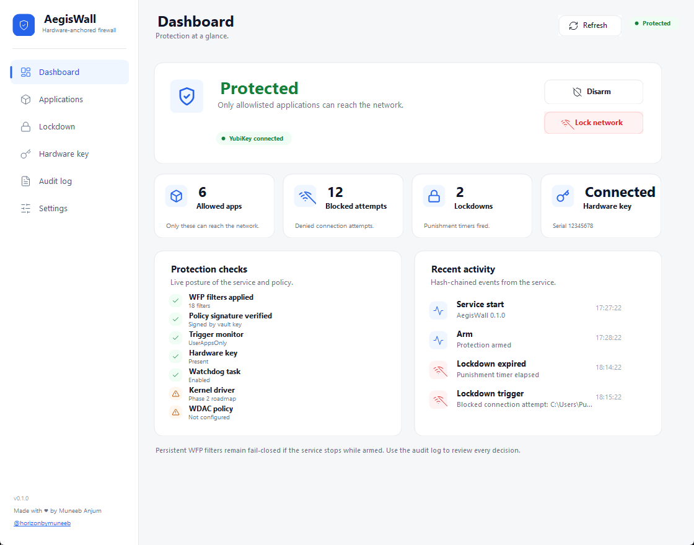
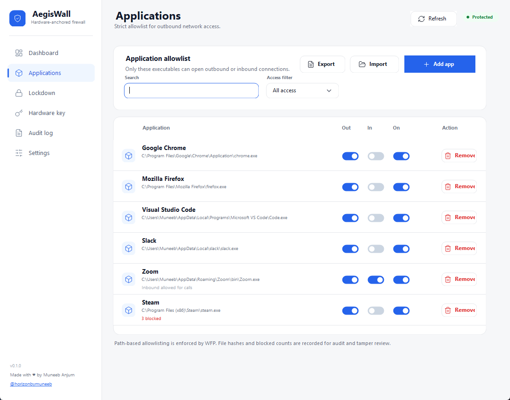
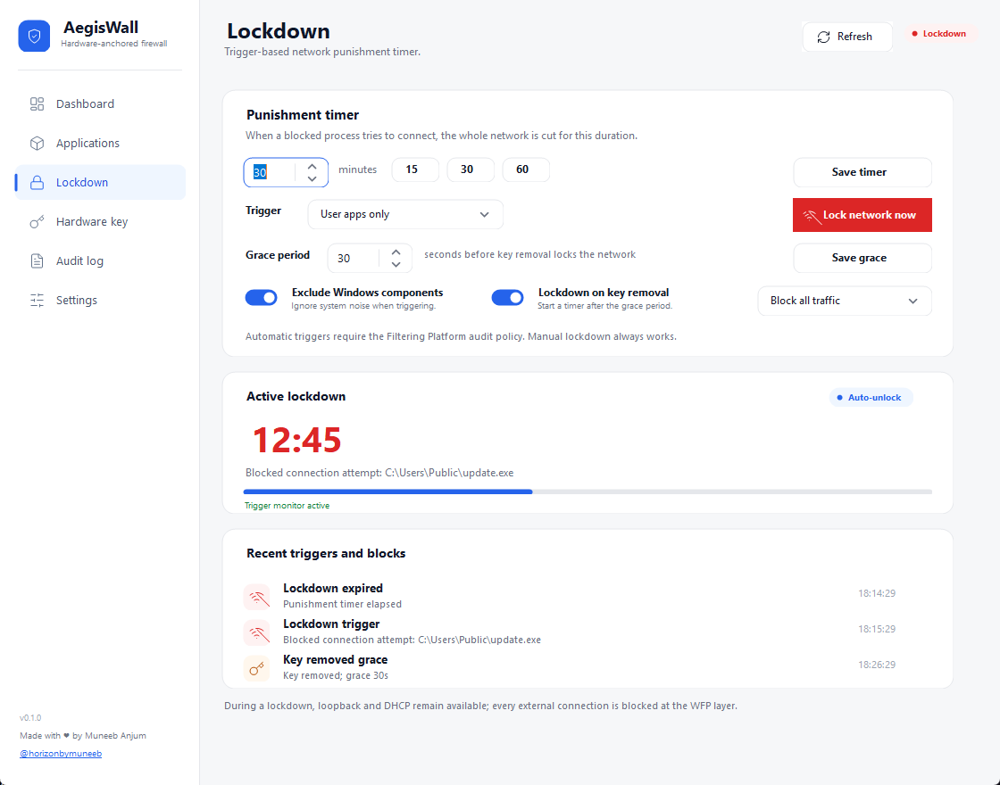
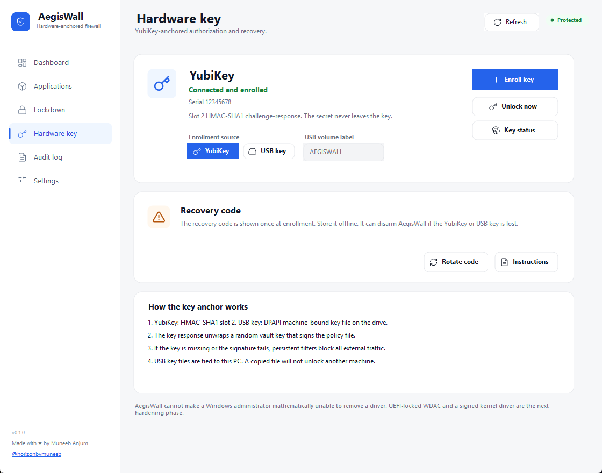
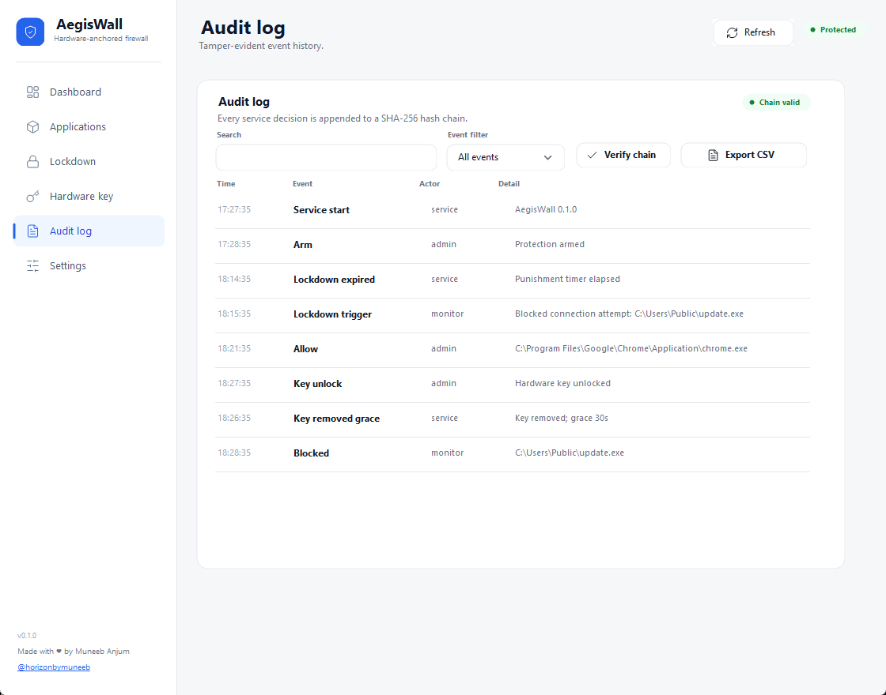
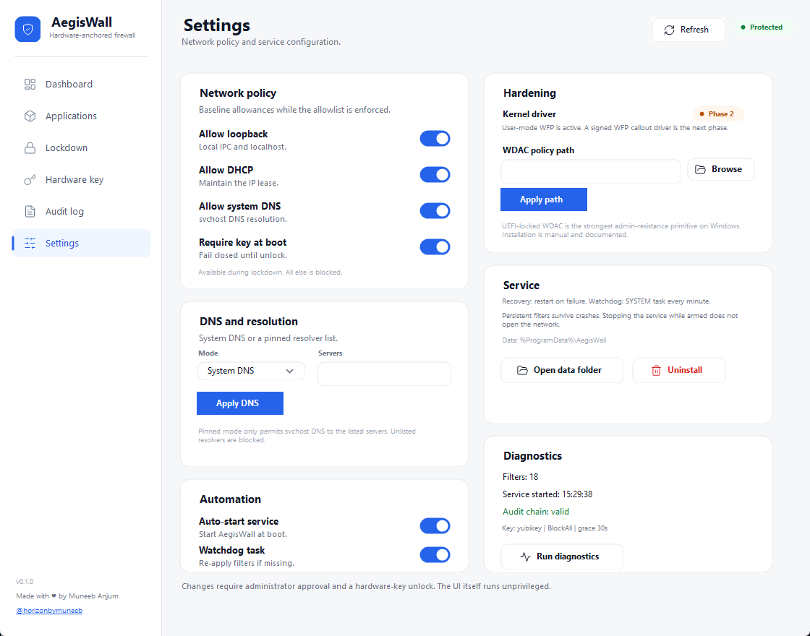

# AegisWall

**Hardware-anchored application firewall and network killswitch for Windows 10 and 11.**

[](https://github.com/horizonbymuneeb/AegisWall/actions/workflows/ci.yml)
[](LICENSE)
[](#requirements)

AegisWall enforces a strict per-application allowlist with Windows Filtering Platform (WFP), anchors policy changes to a **YubiKey or USB hardware key**, and cuts the whole network for a configurable punishment timer when an unapproved process tries to connect.



## Why AegisWall?

| Typical firewall | AegisWall |
| --- | --- |
| Per-app rules buried in Control Panel | One clean allowlist with per-app outbound/inbound toggles |
| Malware can disable the UI | Persistent WFP filters stay fail-closed if the service stops |
| Policy is editable by any admin | Policy is signed with a vault key unlocked by a hardware key |
| No punishment for blocked attempts | Trigger-based lockdown for 15/30/60/custom minutes |
| No hardware anchor | YubiKey HMAC-SHA1 slot 2 or a machine-bound USB key |
| Silent decisions | Hash-chained audit log, exportable to CSV |

## Features

- **Strict application allowlist** — only approved executables can reach the network.
- **Per-app control** — outbound, inbound and enabled toggles for every app.
- **Trigger-based lockdown** — a blocked connection cuts all external traffic for a custom timer.
- **Grace period** — reinsert the hardware key within 30 seconds (configurable) before fail-closed.
- **YubiKey anchor** — HMAC-SHA1 challenge-response in slot 2, with optional touch policy.
- **USB key anchor** — a DPAPI machine-bound `aegiswall.key` on a labeled USB drive.
- **Fail-closed** — persistent WFP filters remain if the service crashes or is stopped while armed.
- **Signed policy** — the config is HMAC-signed by a vault key unlocked by the hardware key.
- **Tamper-evident audit** — every decision is appended to a SHA-256 hash chain.
- **Portable mode** — PowerShell-hosted UI, CLI and service for PCs with Smart App Control enabled.
- **CLI automation** — allow, remove, arm, disarm, lockdown, import/export, diagnostics.
- **No cloud** — no accounts, telemetry or network calls. Everything is local.

## How it works

```text
UI / CLI
   │  named pipe (admin only)
   â–¼
AegisWall service ── WFP ALE filters ── outbound/inbound allowlist
   │                                  └─ persistent default-deny
   ├─ config.json (HMAC-signed)
   ├─ audit.jsonl (SHA-256 chain)
   └─ hardware key (YubiKey HMAC or USB DPAPI key file)
```

- Filters are installed at `ALE_AUTH_CONNECT_V4/V6` and `ALE_AUTH_RECV_ACCEPT_V4/V6`.
- A default-deny block filter is always present while armed.
- Allow filters are added for approved apps; loopback, DHCP and system DNS can be permitted.
- Lockdown adds a higher-weight block filter at all four layers.
- The service writes `%ProgramData%\AegisWall\status.json` for the unprivileged UI.
- Policy changes require administrator approval plus a hardware-key unlock.

## Requirements

- Windows 10 or Windows 11, 64-bit.
- Windows PowerShell 5.1.
- Administrator rights for installation and service control.
- A YubiKey (slot 2 free) **or** a USB drive with a volume label such as `AEGISWALL`.

## Install

### Option A - MSI installer (recommended)

Download one of these from the latest release:

- `AegisWall-0.1.0-x64.msi` - compiled service and UI.
- `AegisWall-Portable-0.1.0-x64.msi` - PowerShell-hosted mode for Smart App Control PCs.

Double-click the MSI, or install silently:

```powershell
msiexec /i .\AegisWall-0.1.0-x64.msi /l*v install.log
```

Then launch **AegisWall** from the Start menu or desktop shortcut.

### Option B - ZIP build

1. Download the latest release ZIP and extract it.
2. Open an elevated PowerShell in the extracted folder.
3. Run:

```powershell
.\install.ps1
```

4. Launch `C:\Program Files\AegisWall\AegisWall.UI.exe`.
5. Enroll a YubiKey or USB key, add apps, then arm protection.

> [!IMPORTANT]
> Unsigned builds can be blocked by **Smart App Control**. Use the portable MSI or `.\install.ps1 -Portable`, or ship a signed release. See [docs/SMART-APP-CONTROL.md](docs/SMART-APP-CONTROL.md).

### Option C - portable mode from source (SAC-safe)

```powershell
.\install.ps1 -Portable
```

Launch:

```text
C:\Program Files\AegisWall\AegisWall-Portable.bat
```

Portable mode runs the UI, CLI and service through the signed PowerShell host. If the portable MSI itself is blocked, use the ZIP release and run `AegisWall-Portable.bat`. It compiles the C# sources in memory at launch. The portable service is registered as a PowerShell-hosted Windows service.

### Option D - build from source

```powershell
git clone https://github.com/horizonbymuneeb/AegisWall.git
cd AegisWall
.\build.ps1
.\install.ps1 -SkipBuild
```

## Enroll a hardware key

### YubiKey

1. Insert the YubiKey.
2. In the UI, choose **YubiKey** as the enrollment source.
3. Click **Enroll key** and approve the elevated prompt.
4. Touch the key when it blinks.
5. Save the recovery code offline.

Enrollment programs **slot 2** with a random HMAC-SHA1 secret and requires touch for each response. If slot 2 is already used, choose `--no-program` and an existing challenge-response credential.

### USB key

1. Format a USB drive and set its volume label to `AEGISWALL` (or choose another label).
2. Insert the drive.
3. In the UI, choose **USB key**, enter the label, and click **Enroll key**.
4. Save the recovery code offline.

The USB key file is protected with Windows DPAPI **machine scope**. It will not unlock another PC. An administrator on the same PC can decrypt it; use a YubiKey if you need a secret that never leaves the hardware.

## Daily use

- **Applications** — add apps, toggle outbound/inbound/enabled, search, import/export JSON.
- **Lockdown** — set the timer, grace period, trigger rules and manual lockdown.
- **Hardware key** — enroll, unlock, rotate the recovery code, inspect serial/provider.
- **Audit log** — search, filter, verify the hash chain, export CSV.
- **Settings** — loopback/DHCP/DNS, pinned DNS, auto-start, watchdog, WDAC path, diagnostics.

## CLI

Compiled:

```powershell
AegisWall.Cli.exe status
AegisWall.Cli.exe enroll --usb --volume AEGISWALL
AegisWall.Cli.exe allow "C:\Program Files\App\app.exe"
AegisWall.Cli.exe allow "C:\Program Files\App\app.exe" --inbound
AegisWall.Cli.exe update-app "C:\Program Files\App\app.exe" --outbound true --inbound false
AegisWall.Cli.exe arm
AegisWall.Cli.exe lockdown 30
AegisWall.Cli.exe unlock
AegisWall.Cli.exe export allowlist.json
AegisWall.Cli.exe import allowlist.json
AegisWall.Cli.exe audit 200
AegisWall.Cli.exe diagnostics
AegisWall.Cli.exe rotate-recovery
AegisWall.Cli.exe disarm --recovery <code>
```

Portable:

```powershell
powershell -NoProfile -ExecutionPolicy Bypass `
  -File "C:\Program Files\AegisWall\Run-AegisWall-Cli.ps1" status
```

## Screenshots

| Applications | Lockdown |
| --- | --- |
|  |  |

| Hardware key | Audit log |
| --- | --- |
|  |  |

| Settings |
| --- |
|  |

## Threat model and honest limits

AegisWall is a strong **user-mode** enforcement layer. It is not a hypervisor or a Microsoft-signed ELAM/PPL component.

- A local administrator or SYSTEM can remove WFP filters, stop the service or load a vulnerable driver. The next hardening phases are a signed WFP callout driver, UEFI-locked WDAC, and protected service signing.
- The USB key is machine-bound with DPAPI. It stops casual copying, not an administrator on the same PC.
- The YubiKey HMAC secret stays in the key, but a malware process can ask for a challenge if the key is inserted and the user touches it. Physical presence is the boundary.
- System DNS runs through `svchost.exe`. Pinned DNS mode restricts it to the configured resolvers; DNS tunneling remains a residual risk.
- Automatic trigger detection uses the Windows Filtering Platform audit policy (`5157` events). If audit policy is unavailable, manual lockdown still works.
- Persistent filters survive service crashes; they do not survive an administrator deleting them.

Read [docs/THREAT-MODEL.md](docs/THREAT-MODEL.md), [docs/ARCHITECTURE.md](docs/ARCHITECTURE.md), [docs/TEST-PLAN.md](docs/TEST-PLAN.md) and [docs/SMART-APP-CONTROL.md](docs/SMART-APP-CONTROL.md).

## Recovery

- **Key lost** — use the recovery code: `AegisWall.Cli.exe disarm --recovery <code>`.
- **Recovery code lost** — run `uninstall.ps1 -Force`, then reinstall. Filters are removed; the old policy is gone.
- **Service stuck** — `AegisWall.Cli.exe status`, then `reset --force` from an elevated prompt.

## Roadmap

- [ ] Signed WFP callout driver with hash enforcement
- [ ] UEFI-locked WDAC policy generator and installer
- [ ] ELAM/PPL signing path (requires Microsoft signing)
- [ ] Per-app connection statistics and live network view
- [ ] Backup hardware key enrollment
- [ ] MSIX/signed installer and SignPath release pipeline
- [ ] Localization

## Documentation

- [Architecture and sequence diagrams](docs/ARCHITECTURE.md)
- [Test plan (MSI, keys, lockdown, tamper, uninstall)](docs/TEST-PLAN.md)
- [Smart App Control and signing](docs/SMART-APP-CONTROL.md)
- [Threat model and limits](docs/THREAT-MODEL.md)

## Contributing

Issues and pull requests are welcome. Read [CONTRIBUTING.md](CONTRIBUTING.md) and [SECURITY.md](SECURITY.md).

```powershell
.\build.ps1 -Test
```

## License

MIT © 2026 AegisWall contributors. See [LICENSE](LICENSE).


