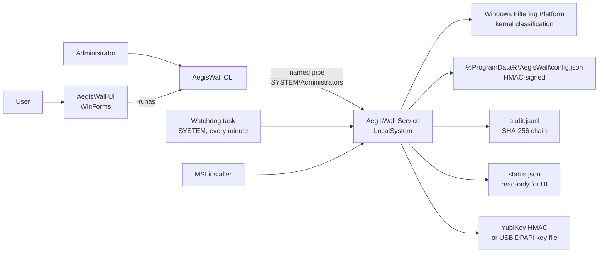
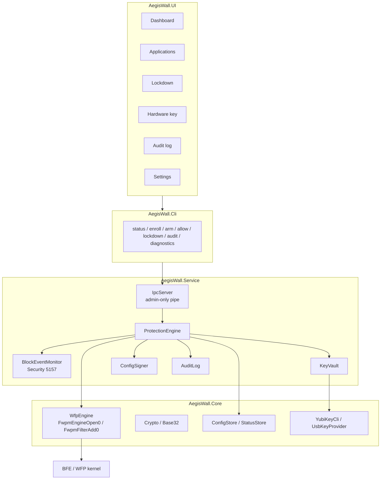
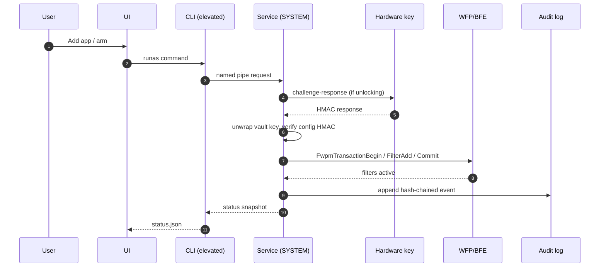
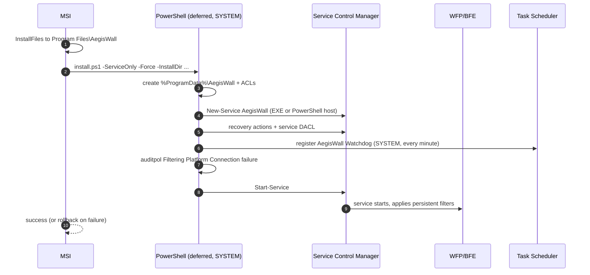
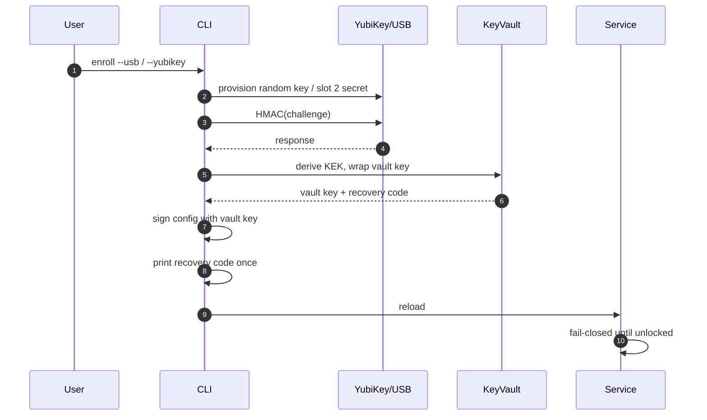
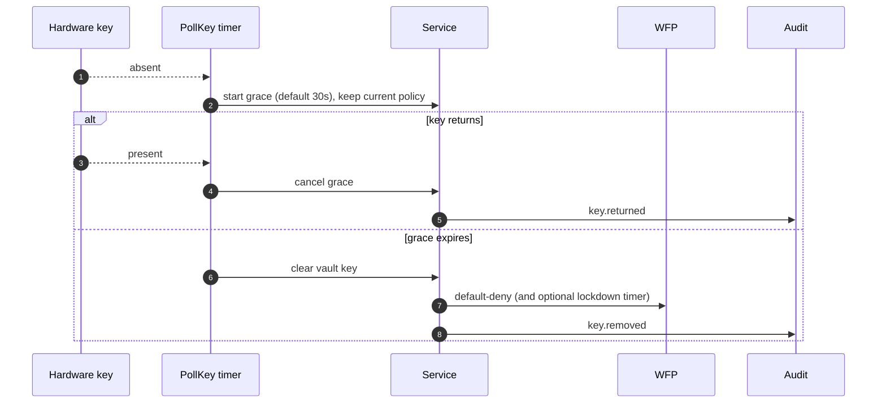
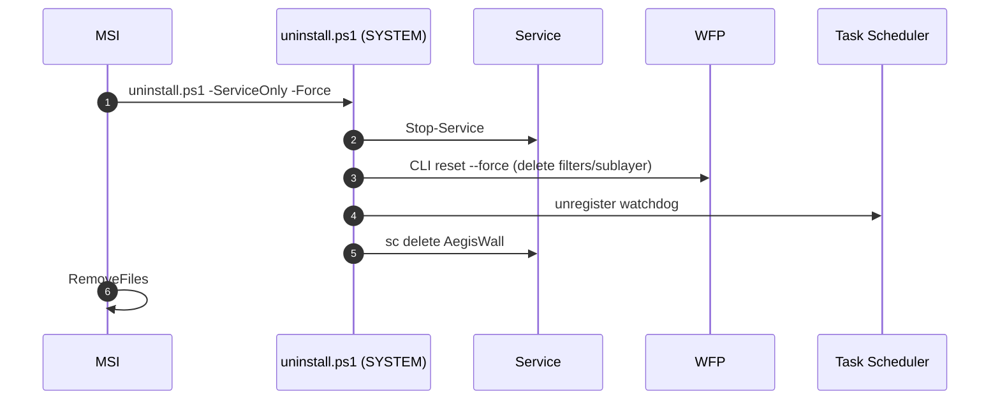

# Architecture

AegisWall is a user-mode control plane over **Windows Filtering Platform (WFP)**. The actual packet classification happens inside the Windows kernel (BFE/WFP). AegisWall does **not** ship a custom `.sys` driver in 0.1.0.

## System context



## Components



## Data flow



## Install sequence (MSI)



## Enrollment sequence



## Blocked attempt -> lockdown

```mermaid
sequenceDiagram
    autonumber
    participant P as Unapproved process
    participant W as WFP
    participant E as Security log
    participant M as BlockEventMonitor
    participant S as ProtectionEngine
    participant A as Audit

    P->>W: connect()
    W-->>P: blocked (persistent deny filter)
    W->>E: event 5157 (Filtering Platform blocked)
    E-->>M: EntryWritten
    M->>S: OnBlockedConnection(app, pid)
    S->>S: debounce 60s, counters++
    S->>S: set lockdownUntil = now + minutes
    S->>W: add higher-weight block filters (4 layers)
    S->>A: lockdown.trigger
    Note over S: countdown; loopback/DHCP remain allowed
    S->>W: remove lockdown filters at expiry
    S->>A: lockdown.expired
```

## Key removal grace



## Uninstall sequence



## Kernel and registry details

### Kernel

- **No custom kernel driver.** AegisWall calls the documented WFP user-mode API (`fwpuclnt.dll`):
  - `FwpmEngineOpen0`
  - `FwpmSubLayerAdd0`
  - `FwpmFilterAdd0`
  - `FwpmTransactionBegin0` / `Commit0`
  - `FwpmFilterDeleteByKey0`
  - `FwpmGetAppIdFromFileName0`
- The **Base Filtering Engine (BFE)** and WFP classify packets in kernel mode.
- Filters are installed at:
  - `FWPM_LAYER_ALE_AUTH_CONNECT_V4/V6`
  - `FWPM_LAYER_ALE_AUTH_RECV_ACCEPT_V4/V6`
- Persistent filters are stored by BFE and restored across BFE restarts.
- A future release may add a signed WFP callout driver for runtime hash/signature enforcement. That is **not** present in 0.1.0.

### Registry

AegisWall does not create custom kernel registry keys or hooks. It touches:

| Location | Purpose |
| --- | --- |
| `HKLM\SYSTEM\CurrentControlSet\Services\AegisWall` | Service registration created by SCM |
| `HKLM\SYSTEM\CurrentControlSet\Control\CI\Policy\VerifiedAndReputablePolicyState` | Read-only SAC detection |
| WFP persistent store (BFE) | Persistent filters/sublayer |
| Task Scheduler store | `AegisWall Watchdog` task |
| `HKLM\Software\AegisWall` | MSI shortcut key path |

The app does **not** patch `netsh`, Windows Firewall rules, LSPs, NDIS, or kernel callbacks.

### Files

| Path | Purpose |
| --- | --- |
| `%ProgramData%\AegisWall\config.json` | Signed policy, allowlist, key vault blobs |
| `%ProgramData%\AegisWall\status.json` | Read-only UI status |
| `%ProgramData%\AegisWall\audit.jsonl` | Hash-chained audit events |
| `%ProgramData%\AegisWall\service-bootstrap.log` | Portable service compile/start errors |
| `C:\Program Files\AegisWall` | Binaries, source (portable), docs, scripts |

## Security invariants

1. While armed, a default-deny block filter exists at all four ALE layers.
2. The allowlist is only applied if the config HMAC verifies with the vault key.
3. A missing key or invalid signature never opens the network.
4. The control pipe is restricted to SYSTEM and Administrators.
5. Every decision is appended to a hash chain.
6. The UI never writes config directly; it launches an elevated CLI action.
7. Persistent filters remain if the service crashes.

## Known limits

- Admin/SYSTEM can remove filters; see `THREAT-MODEL.md`.
- No custom kernel driver; no runtime hash enforcement yet.
- USB key uses DPAPI machine scope.
- System DNS is allowed through `svchost.exe`; pinned mode narrows the destination.
- Automatic trigger detection needs the Filtering Platform audit policy.
